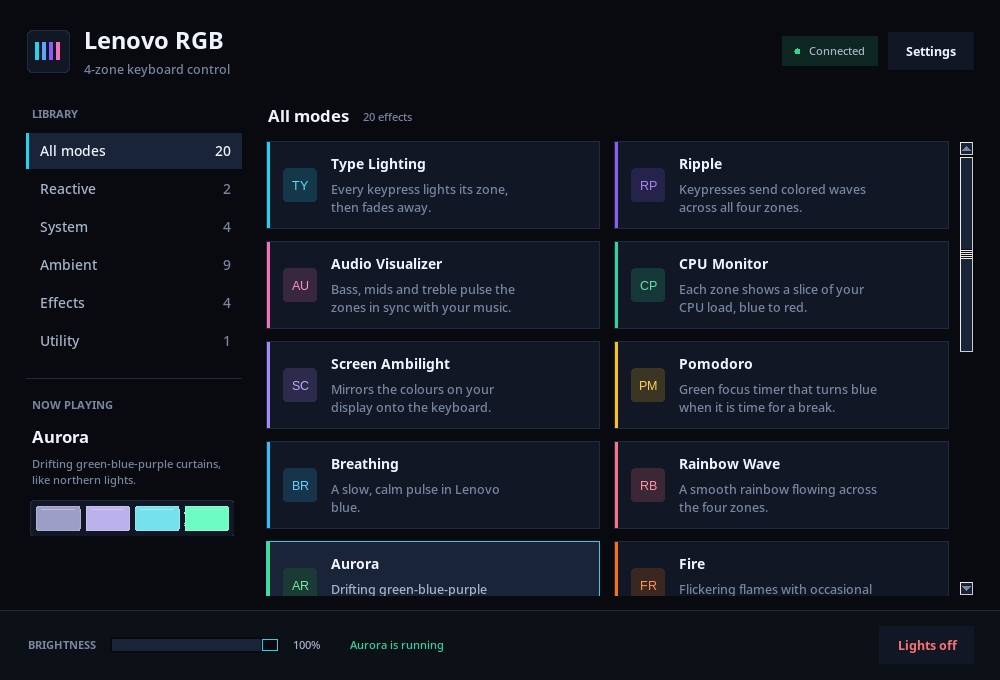

<div align="center">


# Lenovo RGB

**Turn the 4-zone RGB keyboard on Lenovo LOQ and Legion laptops into a live display — on Linux and Windows.**

[](https://github.com/Shushant17711/LenovoRGB/actions/workflows/ci.yml)
[](LICENSE)
[](https://www.python.org/)
[](#install)
[](https://github.com/Shushant17711/LenovoRGB/releases)

<a href="docs/screenshot.png"></a>

<sub>Live preview, one-click modes, and brightness control. Screenshot captured with a simulated connected device.</sub>

</div>

---

Lenovo RGB talks directly to the keyboard's vendor HID interface, so you do not need Lenovo Vantage, Legion Space, iCUE, or a Windows driver. It started as a Windows-only script and has been rewritten as a small cross-platform app with a proper installer, a tray icon, a mode plugin system, and tests.

- **20 lighting modes** — reactive typing, ripple, audio visualizer, CPU monitor, screen ambilight, Pomodoro, aurora, fire, plasma, matrix, lightning storm, and more.
- **One-command install** — Linux installer sets up the venv, udev rule, menu entry, CLI command, and login autostart. Windows installer creates a Start Menu shortcut and login entry.
- **Same app on both platforms** — `hidraw` on Linux, `hidapi` on Windows. The Linux build detects the RGB collection correctly instead of relying on the Windows-only HID path.
- **Live UI** — dark card-based interface, four-zone preview mirroring the real LEDs, brightness slider, tray menu, and global mode-cycle hotkey.
- **Modern internals** — one device owner, one mode thread, a single-instance lock, atomic config writes, automatic reconnect after suspend, and lights-off cleanup on exit.
- **No telemetry, no accounts, no network calls.**

## Install

### Linux

```bash
git clone https://github.com/Shushant17711/LenovoRGB.git
cd LenovoRGB
./install.sh
```

The installer:

1. creates `.venv/` and installs the package with all optional extras (and offers to install the system Tk package if it is missing);
2. installs `packaging/99-lenovorgb.rules` so your user can reach `/dev/hidraw*` without root;
3. adds the `lenovorgb` command to `~/.local/bin`;
4. adds an application-menu entry and enables launch-at-login in the tray;
5. on Wayland, asks once whether to add you to the `input` group for key-reactive modes (a logout is required).

Then run:

```bash
lenovorgb
```

If `~/.local/bin` is not on your `PATH`, add it to `~/.bashrc` or `~/.zshrc`:

```bash
export PATH="$HOME/.local/bin:$PATH"
```

> Do **not** run `sudo ./install.sh`. The script asks for sudo only for the udev rule and the optional input group.

**Arch / Omarchy / CachyOS**

```bash
sudo pacman -S --needed python tk libpulse grim
./install.sh
```

`grim` is only needed for Screen Ambilight on Wayland. On X11, the bundled `mss` package handles capture. The audio visualizer needs the PulseAudio client library (`libpulse`); the installer warns if it is missing.

Installer flags:

| Flag | Effect |
|---|---|
| `--no-udev` | Skip the udev rule (run as root manually later) |
| `--no-autostart` | Do not start the app at login |
| `--with-input` | Add your user to the `input` group (Wayland key effects) |
| `--no-input` | Never touch the `input` group |
| `--cli-only` | Skip the tkinter check and install the CLI only |
| `--dev` | Also install pytest, ruff and PyInstaller |
| `-y`, `--yes` | Do not prompt |

Manual install, if you prefer:

```bash
python3 -m venv .venv
.venv/bin/pip install -e ".[all]"
sudo install -m644 packaging/99-lenovorgb.rules /etc/udev/rules.d/
sudo udevadm control --reload-rules && sudo udevadm trigger --subsystem-match=hidraw
.venv/bin/lenovorgb
```

### Windows

**Option A — prebuilt executable**

Download `LenovoRGB.exe` from [Releases](https://github.com/Shushant17711/LenovoRGB/releases), put it somewhere permanent, and run it. Open **Settings → Launch at login** to start it with Windows.

The executable is unsigned, so SmartScreen may show "Windows protected your PC". Choose **More info → Run anyway**.

**Option B — install from source**

```powershell
git clone https://github.com/Shushant17711/LenovoRGB.git
cd LenovoRGB
.\install.bat
```

`install.bat` creates `.venv`, installs the dependencies, creates a Start Menu shortcut, and adds the tray app to login startup. If Windows blocks HID access, run an elevated install instead:

```powershell
powershell -ExecutionPolicy Bypass -File install.ps1 -Elevated
```

That registers a scheduled task with the highest privileges. To build the standalone `.exe` yourself:

```powershell
.\build.bat
# output: dist\LenovoRGB.exe
```

Before using the app, open Lenovo Vantage once and set the keyboard lighting profile to **Static** (or **Off**), so Vantage stops fighting for the controller.

### Other platforms

The Python package runs on macOS for development, but Lenovo 4-zone RGB hardware on macOS is untested. The CLI and UI start; hardware support is best-effort.

## Quick start

| Command | What it does |
|---|---|
| `lenovorgb` | Open the desktop app |
| `lenovorgb list` | List every mode and its ID |
| `lenovorgb run aurora` | Run Aurora until Ctrl+C |
| `lenovorgb run type` | Reactive typing mode |
| `lenovorgb run audio` | Audio visualizer |
| `lenovorgb solid "#ff5500"` | Solid colour |
| `lenovorgb off` | Turn the lighting off |
| `lenovorgb doctor` | Diagnose device, permissions, audio, screen capture |
| `lenovorgb autostart enable` | Start in the tray at login |
| `lenovorgb autostart disable` | Remove login startup |
| `lenovorgb shortcut install` | Add the application-menu entry |

Add `--demo` (or `--dry-run`) to any `run` command to preview a mode without writing to the keyboard:

```bash
lenovorgb run fire --demo
```

Old `--mode` invocations still work:

```bash
python -m lenovorgb --mode fire
```

## Modes

| ID | Mode | Category | What it does |
|---|---|---|---|
| `type` | Type Lighting | Reactive | Each key lights its zone in a vivid colour and fades out. |
| `ripple` | Ripple | Reactive | Keypresses send coloured rings across all four zones. |
| `audio` | Audio Visualizer | System | Bass, mids, treble and overall volume drive the zones. |
| `cpu` | CPU Monitor | System | Each zone shows the load of a CPU core group, blue → red. |
| `screen` | Screen Ambilight | System | Mirrors the colours of your display. |
| `pomodoro` | Pomodoro | System | Green focus timer; blue short break, purple long break. |
| `breathing` | Breathing | Ambient | Slow Lenovo-blue pulse. |
| `rainbow` | Rainbow Wave | Ambient | Continuous rainbow flowing across the zones. |
| `aurora` | Aurora | Ambient | Drifting green-blue-purple curtains. |
| `fire` | Fire | Ambient | Flickering flames with bright flare-ups. |
| `plasma` | Plasma | Ambient | Organic multi-frequency colour fields. |
| `heartbeat` | Heartbeat | Ambient | Realistic lub-dub pulse with a drifting hue. |
| `dna` | DNA Helix | Ambient | Counter-rotating cyan and magenta strands. |
| `meteor` | Meteor | Ambient | A glowing meteor bounces across the keyboard. |
| `matrix` | Matrix Rain | Effects | Cyber-green code rain in random bursts. |
| `disco` | Disco | Effects | 130 BPM colour snaps with a white strobe every 8th beat. |
| `storm` | Lightning Storm | Effects | Violet ambience interrupted by multi-stage strikes. |
| `glitch` | Cyberpunk Glitch | Effects | Neon palette with blackouts, inversions and scrambles. |
| `solid` | Solid Color | Utility | One steady colour. Set it in Settings or with `solid`. |
| `off` | Lights Off | Utility | Turns the keyboard illumination off. |

Modes that need audio, screen capture, or global key events fail with a readable message instead of quietly doing nothing. Click the status bar in the app (or run `lenovorgb doctor`) for the fix.

## Configuration

| Platform | Config | Log |
|---|---|---|
| Linux | `~/.config/lenovorgb/config.json` | `~/.local/state/lenovorgb/lenovorgb.log` |
| Windows | `%APPDATA%\LenovoRGB\config.json` | `%LOCALAPPDATA%\LenovoRGB\lenovorgb.log` |

Most settings are in the app's **Settings** dialog: default mode, start minimized, launch at login, cycle hotkey, Pomodoro lengths. The file is written atomically and older v1 configs (`shortcut`, `startup_minimized`) are migrated automatically.

A minimal config:

```json
{
  "default_mode": "type",
  "start_minimized": true,
  "launch_at_login": false,
  "hotkey": "ctrl+shift+m",
  "brightness": 100,
  "off_on_exit": true,
  "static_color": "#5B8CFF"
}
```

Useful extra keys:

| Key | Default | Meaning |
|---|---|---|
| `audio.device` | auto | Substring of the loopback device name |
| `screen.fps` | `20` | Ambilight capture rate |
| `screen.saturation_boost` | `1.6` | Colour boost before sending to the LEDs |
| `device.product_id` | auto | Force a specific USB PID |
| `device.path` | auto | Force a specific HID path |
| `off_on_exit` | `true` | Turn LEDs off when the app quits |

The default global hotkey is **Ctrl+Shift+M**. It cycles through modes; change or disable it in Settings.

## Troubleshooting

| Symptom | Fix |
|---|---|
| `No Lenovo 4-zone RGB keyboard found` | Run `lenovorgb doctor`. On Linux, install the udev rule and re-plug the keyboard. On Windows, open Vantage once and set lighting to Static. |
| `Permission denied` opening the HID interface | `sudo install -m644 packaging/99-lenovorgb.rules /etc/udev/rules.d/` then `sudo udevadm control --reload-rules && sudo udevadm trigger --subsystem-match=hidraw`. Re-plug the keyboard. |
| Type Lighting / Ripple does nothing on Wayland | Global key input needs `/dev/input` access: `sudo usermod -aG input $USER`, then log out and back in. Or switch the session to X11. |
| Audio visualizer is silent | Make sure audio is playing and PipeWire/PulseAudio exposes a monitor source. Check `pactl list short sources`. `lenovorgb doctor` lists the loopback devices it can see. |
| Ambilight stays black on Wayland | Install `grim` (wlroots/Hyprland), `spectacle` (KDE) or `gnome-screenshot` (GNOME). Test with: `grim /tmp/screen.png`. |
| Tray icon is missing on GNOME | GNOME hides legacy tray icons; install the AppIndicator extension. The app and hotkey still work; closing the window quits if no tray is available. |
| Lights stay on after a crash | Run `lenovorgb off`. The app also turns LEDs off on normal exit, Ctrl+C, Windows logoff/shutdown, and SIGTERM. |
| `lenovorgb: command not found` | Add `~/.local/bin` to `PATH` (see above), or run `.venv/bin/lenovorgb`. |
| Hotkey does nothing | The hotkey uses the same input backend as reactive modes. Fix input permissions, or pick another shortcut in Settings. |
| Two instances / lock message | Only one process may own the keyboard. Quit the tray app first (`lenovorgb doctor` shows the PID). |
| Windows exe cannot open the keyboard | Run the installer with `-Elevated`, or right-click the exe and choose "Run as administrator". |

`lenovorgb doctor` prints the OS, session type, detected HID interfaces, permissions, input devices, tkinter availability, audio loopback devices, screen-capture backend, lock state, and the last log lines. Include its output when opening an issue.

## How it works

The keyboard exposes a vendor HID collection with usage page `0xff89` and usage `0x00cc`. Lighting is a 33-byte feature report:

```
CC 16 01 01 01  R0 G0 B0  R1 G1 B1  R2 G2 B2  R3 G3 B3  00 × 16
│  │  │  │  │
│  │  │  │  └─ hardware brightness
│  │  │  └──── speed
│  │  └─────── static/custom submode
│  └────────── command
└───────────── report ID
```

On Linux the app uses the `hidraw` backend from the `hidapi` package, because the libusb backend does not report vendor usage pages and cannot tell the RGB collection from the touchpad. `packaging/99-lenovorgb.rules` grants the active desktop user access via `TAG+="uaccess"`. The app never runs as root.

Supported USB product IDs (`048d:...`): `c995`, `c994`, `c993`, `c985`, `c984`, `c983`, `c975`, `c973`, `c965`, `c963`, `c955`.

If `doctor` finds your keyboard but the product ID is not listed, open an issue with the output of `lsusb -d 048d:` and your laptop model.

### A note on the `input` group

Reactive modes need to see keypresses globally. On X11 and Windows the app uses `pynput`; on Wayland it reads `/dev/input/event*` through `evdev`. That requires membership in the `input` group, which allows reading **all** input devices, including any keyboard. That is the same permission a keylogger would need. It is only used to light the four zones and to fire the mode-cycle shortcut; nothing is logged or transmitted. If you do not want that, skip it — every other mode works without it.

## Development

```bash
python3 -m venv .venv
.venv/bin/pip install -e ".[all,dev]"

.venv/bin/pytest -q          # 116 tests, no hardware required
.venv/bin/ruff check src tests
.venv/bin/python -m lenovorgb list
.venv/bin/python -m lenovorgb run aurora --demo
```

Project layout:

```
src/lenovorgb/
  device.py          HID discovery, protocol, reconnect, dry-run
  engine.py          single mode thread, state and colour callbacks
  cli.py             argparse entry point and signal handling
  config.py          defaults, validation, migration, atomic writes
  modes/             one class per effect, registered in modes/__init__.py
  inputs/keyboard.py evdev + pynput backends, hotkey parsing
  inputs/audio.py    loopback capture
  inputs/screen.py   mss + grim/spectacle/gnome-screenshot
  ui/                Tkinter app, theme, widgets, tray
tests/               unit tests with fake devices; no keyboard needed
packaging/           udev rule, PyInstaller spec, icons
```

Adding a mode is one class:

```python
from .base import Mode

class MyMode(Mode):
    id = "mymode"
    name = "My Mode"
    description = "One line shown in the app."
    category = "ambient"
    accent = "#22d3ee"

    def step(self, dt):
        return [(255, 0, 0)] * 4
```

Register it in `src/lenovorgb/modes/__init__.py`; the CLI, UI, tray and tests pick it up automatically.

Releases are built by GitHub Actions from tags (`v*`): a Windows `LenovoRGB.exe` plus sdist/wheel. See [CHANGELOG.md](CHANGELOG.md) for what changed in 2.0.

## Uninstall

Linux:

```bash
./uninstall.sh            # keep your settings
./uninstall.sh --purge    # remove settings and logs too
```

Windows:

```powershell
.\uninstall.bat
# or: powershell -ExecutionPolicy Bypass -File install.ps1 -Uninstall -Purge
```

## Credits

The HID protocol and the original effect ideas come from the earlier Windows-only LenovoRGB project. This version is an independent rewrite: new device layer, Linux support, mode registry, UI, installers, and tests.

Not affiliated with or endorsed by Lenovo. Use at your own risk; direct HID writes are unsupported by the vendor.

## License

MIT — see [LICENSE](LICENSE).
